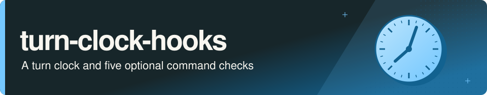
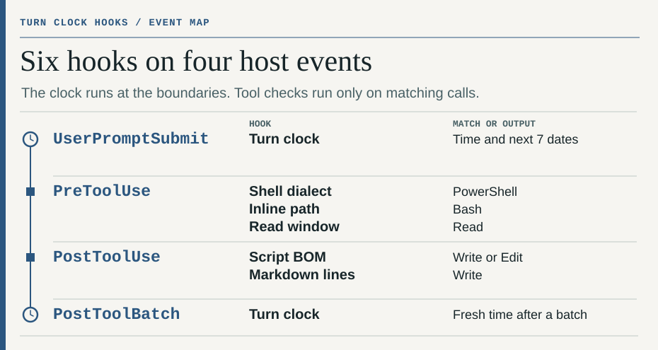

# 

대화에 현재 시각을 넣고, 도구별 검사 다섯 가지 중 필요한 것만 고릅니다.

[](LICENSE)   [](https://github.com/T7H7N/turn-clock-hooks/actions/workflows/tests.yml)

### 무엇을 해결하나요?

- 사용자 입력 때 다음 7일의 날짜와 요일을 보여줍니다.
- 호스트가 지원하면 도구 실행 묶음이 끝날 때 시각을 갱신합니다.
- 도구 실행 전 검사와 쓰기 후 안내를 필요한 만큼 선택합니다.

<picture>
  <source media="(max-width: 600px)" srcset="docs/assets/workflow-compact.svg">
  
</picture>

시계는 입력·도구 묶음 종료 시각을 알려 주고, 선택형 훅은 실행 전 세 가지 검사와 쓰기 후 두 가지 안내를 맡습니다.

**[바로 시작](#설치)**　·　[English](README.md) · 한국어

턴 시계부터 시작합니다. 프롬프트마다, 그리고 도구 실행 묶음이 끝날 때마다 어시스턴트에게 현재 시각을 알려 줍니다. 여기에 프로젝트에 맞는 검사 다섯 가지 가운데 필요한 것을 더합니다. 폴더마다 따로 실행되며 파이썬 3.9 이상과 표준 라이브러리만 있으면 됩니다.

| 훅 | 이벤트와 도구 | 넣어 주거나 검사하는 것 | 의존성 |
| --- | --- | --- | --- |
| [턴 시계](turn-clock/README.md) | UserPromptSubmit, PostToolBatch | 프롬프트 시점의 지역 시각, UTC, 앞으로 7일의 날짜와 요일. 도구 묶음이 끝난 뒤의 새 시각 | 파이썬 |
| [셸 방언](shell-dialect/README.md) | PreToolUse · PowerShell | PowerShell 파이프라인에 섞인 POSIX 명령 형태 | 파이썬 |
| [인라인 경로](inline-path/README.md) | PreToolUse · Bash | 인라인 코드나 텍스트 생성 중에 경로가 바뀌는 경우 | 파이썬 |
| [스크립트 BOM](script-bom/README.md) | PostToolUse · Write, Edit | 구버전 Windows PowerShell이 저장된 스크립트의 문자 인코딩을 잘못 인식할 수 있는 경우 | 파이썬 |
| [마크다운 줄 길이](markdown-lines/README.md) | PostToolUse · Write | 수정 내용을 diff에서 가리는 긴 마크다운 줄 | 파이썬 |
| [읽기 범위](read-window/README.md) | PreToolUse · Read | 큰 텍스트 파일을 범위 없이 통째로 읽는 경우 | 파이썬 |

## 턴 시계 출력 예

UTC와 영어를 고른 상태에서 프롬프트 훅이 표준 출력에 쓴 JSON 한 줄입니다. 호스트는 `additionalContext`로 달력을 받습니다.

```text
{"hookSpecificOutput": {"hookEventName": "UserPromptSubmit", "additionalContext": "Now: 2026-11-27T09:35:28+00:00 (Fri) | UTC: 2026-11-27T09:35:28Z | Next 7 days: 2026-11-28 Sat, 2026-11-29 Sun, 2026-11-30 Mon, 2026-12-01 Tue, 2026-12-02 Wed, 2026-12-03 Thu, 2026-12-04 Fri"}}
```

턴 시계는 사용자 입력 때 현재 날짜·요일·시각과 앞으로 7일을 알려 주고, 긴 작업 중에는 도구 실행 묶음이 끝날 때마다 그 시점의 시각을 다시 알려 줍니다. 경과 시간을 계산해 주지는 않습니다. 요일과 기간 계산은 암산 대신 날짜 명령으로 하게 하는 규칙을 함께 쓰기를 권합니다([턴 시계 안내](turn-clock/README.md)).

## 설치

1. 고른 폴더를 직접 관리하는 고정된 위치에 복사합니다. 묶음을 푼 자리에서 `python -B install_check.py`를 실행하면 등록 예시 전체를 점검하고 명령별 시간을 잽니다. 훅 하나의 동작 점검은 그 폴더 안에서 `python -B test_hook.py`를 실행합니다.
2. [영문 설치 예시](README.md#install)의 JSON에서 `HOOKS_HOME`을 설치한 훅 폴더들의 상위 디렉터리 전체 경로로 바꿉니다. 슬래시(`/`)를 쓰고, 공백에 대비해 따옴표는 그대로 둡니다. 셸 특수 문자가 없는 위치를 씁니다. 호스트에서 `python`이 파이썬 3.9 이상으로 풀려야 합니다. 인터프리터 이름이 `python3`이면 각 명령에서 그 이름을 씁니다.
3. 호스트에 PostToolBatch가 없으면 시계의 UserPromptSubmit 항목만 고릅니다. 고른 항목을 사용자 또는 프로젝트 `settings.json`의 기존 `hooks` 객체에 합칩니다. 이미 있는 이벤트 배열에는 항목을 덧붙입니다. 설정을 다시 불러온 뒤, 호스트의 훅 화면에서 고른 이벤트와 도구 필터(`matcher`)가 등록됐는지 확인합니다. 명령 하나를 끄려면 그 항목을 지웁니다.

등록 예시 JSON 전체는 [영문 README](README.md#install)에 있습니다.

명령은 표준 입력으로 UTF-8 JSON을 받습니다. 종료 코드 0과 빈 표준 출력은 호스트의 판단에 맡긴다는 뜻입니다. 도구 실행을 거부하는 훅은 이유가 담긴 JSON을 돌려줍니다. 쓰기·수정 뒤에 검사하는 훅은 그 작업이 성공한 뒤 안내가 담긴 JSON을 돌려줍니다. 시계는 등록된 두 이벤트에서 추가 컨텍스트를 돌려줍니다. 훅은 이력을 남기지 않습니다.

기본 설치 점검은 각 명령이 500ms 미만에 끝나야 통과합니다. 공용 실행 환경에서 `python -B install_check.py --report-timing`을 쓰면 실행 시간은 표시만 하고, 등록이나 응답이 잘못됐을 때는 그대로 실패합니다.

## 플랫폼 참고

셸 방언 검사는 PowerShell 도구와 윈도우의 명령 해석을 전제로 합니다. 유닉스에는 POSIX 프로그램이 원래 있는 경우가 많으므로 골라서 켭니다. 인라인 경로 검사는 Bash 도구가 윈도우 경로를 다룰 때 적용됩니다(다른 호스트에서도 같습니다). BOM 검사는 윈도우 PowerShell 5.1에 배포되는 스크립트를 대상으로 합니다. 줄 길이 검사와 읽기 범위 검사는 플랫폼과 무관하게 로컬 파일과 페이로드에서 동작합니다. 도구 이름은 쓰시는 호스트가 내보내는 이름에 맞춥니다.

## 관련 작업

훅 모음, PDF 분류, 세션 간 미결 작업 추적 사례는 [영문 README의 Related work](README.md#related-work)에 있습니다. [턴 시계 안내](turn-clock/README.md#prior-work)에서 비교한 세 구현에서는 7일 미리보기, 도구 묶음 뒤 시각 갱신, 날짜 명령 사용을 함께 제공하는 사례를 확인하지 못했습니다.

훅별 안내 문서는 영어로만 제공됩니다.
