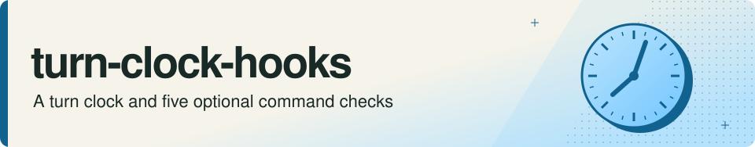
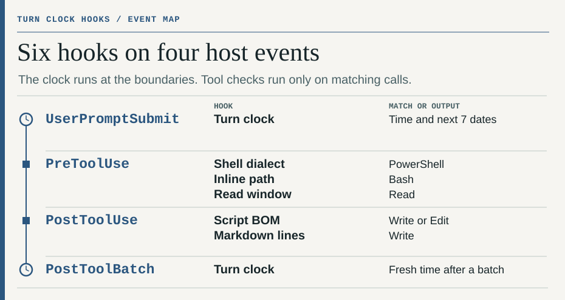
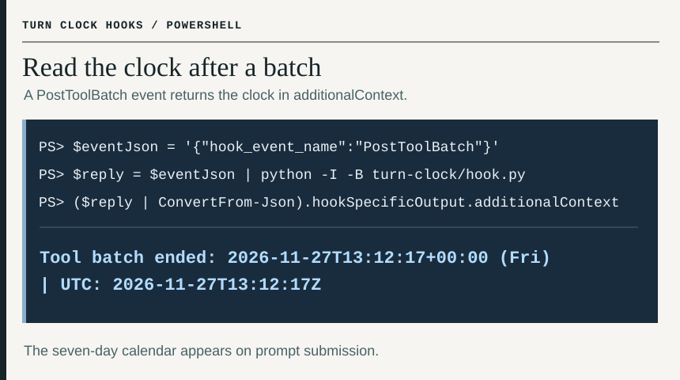

<h1><picture>
  <source media="(prefers-color-scheme: dark)" srcset="docs/assets/banner.svg">
  
</picture></h1>

Put current time into the conversation and choose checks for individual tool calls.

[](LICENSE)   [](https://github.com/T7H7N/turn-clock-hooks/actions/workflows/tests.yml)

**[Get started](#install)**　·　English · [한국어](README.ko.md)

### What it solves

<table>
<tr>
  <td width="33%" valign="top"><br><strong>Date preview</strong><br>Preview the next seven dates and weekdays at prompt time.</td>
  <td width="33%" valign="top"><br><strong>Clock refresh</strong><br>Refresh the clock when a tool batch ends on a supported host.</td>
  <td width="33%" valign="top"><br><strong>Optional checks</strong><br>Choose pre-use checks and post-write advisories independently.</td>
</tr>
</table>

<picture>
  <source media="(max-width: 600px)" srcset="docs/assets/workflow-compact.svg">
  
</picture>

<picture>
  <source media="(max-width: 600px)" srcset="docs/assets/usage-compact.svg">
  
</picture>

Start with the turn clock to give the assistant a current timestamp at each prompt and after tool batches. Add any of the five checks that suit your project. Each folder runs independently with Python 3.9 or later and the standard library.

| Hook | Event and tool | What it adds or checks | Dependencies |
| --- | --- | --- | --- |
| [Turn clock](turn-clock/README.md) | UserPromptSubmit, PostToolBatch | Local time, UTC, and a seven-day weekday preview at prompt time; a fresh time after a tool batch | Python |
| [Shell dialect](shell-dialect/README.md) | PreToolUse · PowerShell | POSIX command forms in a PowerShell pipeline | Python |
| [Inline path](inline-path/README.md) | PreToolUse · Bash | Path changes during inline code or text generation | Python |
| [Script BOM](script-bom/README.md) | PostToolUse · Write, Edit | Legacy decoding of a saved script | Python |
| [Markdown lines](markdown-lines/README.md) | PostToolUse · Write | Long Markdown lines that hide edits in diffs | Python |
| [Read window](read-window/README.md) | PreToolUse · Read | Unbounded reads of large text files | Python |

## Example from the turn clock

With UTC and English selected, the prompt hook wrote this JSON line to stdout. The host receives the calendar in `additionalContext`:

```text
{"hookSpecificOutput": {"hookEventName": "UserPromptSubmit", "additionalContext": "Now: 2026-11-27T09:35:28+00:00 (Fri) | UTC: 2026-11-27T09:35:28Z | Next 7 days: 2026-11-28 Sat, 2026-11-29 Sun, 2026-11-30 Mon, 2026-12-01 Tue, 2026-12-02 Wed, 2026-12-03 Thu, 2026-12-04 Fri"}}
```

## Install

1. Copy your selected folders to a stable location you control. From the unpacked collection, run `python -B install_check.py` to check all registration examples and time each command. Run `python -B test_hook.py` inside an individual folder for its behavior checks.
2. Replace `HOOKS_HOME` below with the full parent directory of the installed folders. Use forward slashes and keep the quotes for spaces. Use a location without shell metacharacters. The host must resolve `python` to Python 3.9 or later. If your interpreter is named `python3`, use that name in each command.
3. If your host lacks PostToolBatch, select only the clock's UserPromptSubmit entry. Merge the selected entries into the existing `hooks` object in your user or project `settings.json`. Append entries to existing event arrays. Reload the host settings and check the selected matchers in its hooks view. To disable one command, remove its entry.

```json
{
  "hooks": {
    "UserPromptSubmit": [
      {
        "hooks": [
          {
            "type": "command",
            "command": "python -I -B \"HOOKS_HOME/turn-clock/hook.py\""
          }
        ]
      }
    ],
    "PostToolBatch": [
      {
        "hooks": [
          {
            "type": "command",
            "command": "python -I -B \"HOOKS_HOME/turn-clock/hook.py\""
          }
        ]
      }
    ],
    "PreToolUse": [
      {
        "matcher": "PowerShell",
        "hooks": [
          {
            "type": "command",
            "command": "python -I -B \"HOOKS_HOME/shell-dialect/hook.py\""
          }
        ]
      },
      {
        "matcher": "Bash",
        "hooks": [
          {
            "type": "command",
            "command": "python -I -B \"HOOKS_HOME/inline-path/hook.py\""
          }
        ]
      },
      {
        "matcher": "Read",
        "hooks": [
          {
            "type": "command",
            "command": "python -I -B \"HOOKS_HOME/read-window/hook.py\""
          }
        ]
      }
    ],
    "PostToolUse": [
      {
        "matcher": "Write|Edit",
        "hooks": [
          {
            "type": "command",
            "command": "python -I -B \"HOOKS_HOME/script-bom/hook.py\""
          }
        ]
      },
      {
        "matcher": "Write",
        "hooks": [
          {
            "type": "command",
            "command": "python -I -B \"HOOKS_HOME/markdown-lines/hook.py\""
          }
        ]
      }
    ]
  }
}
```

Commands receive UTF-8 JSON on standard input. Exit code zero and empty stdout defer to the host. A pre-use denial returns JSON with a reason. Post-use advisories return JSON containing additional context after a successful write or edit. The clock returns additional context on its two registered events. The hooks keep no history.

The default installation check also enforces its 500 ms per-process startup budget. Use `python -B install_check.py --report-timing` on shared runners to report latency while keeping registration and reply failures fatal.

## Platform notes

The shell-dialect check assumes a PowerShell tool and Windows command resolution. On Unix, native POSIX programs are common and the check should be enabled selectively. The inline-path check applies when a Bash tool handles Windows paths, including on a different host. The BOM check targets scripts distributed to Windows PowerShell 5.1. The line and read checks work with local files and payloads across platforms. Match tool names to those exposed by your host.

## Related work

Existing hook collections cover adjacent problems. One combines context usage, unread items and pending work in its status line and provides handoff and wake hooks. Another demonstrates pre-use write protection for environment files. [Session hooks and status line](https://github.com/hex/claude-sessions) · [Hook examples and write guards](https://github.com/disler/claude-code-hooks-mastery)

A PDF inspector classifies pages to guide OCR decisions. For a scanned document, page classification answers a different question from the file-size check here. [PDF inspection](https://github.com/firecrawl/pdf-inspector)

For work that spans sessions, agent-loom tracks roles and outstanding obligations. Its persistent records can answer which role owes a response after a handoff. The hooks in this collection evaluate individual tool calls. [Roles and obligations](https://github.com/osteele/agent-loom)
